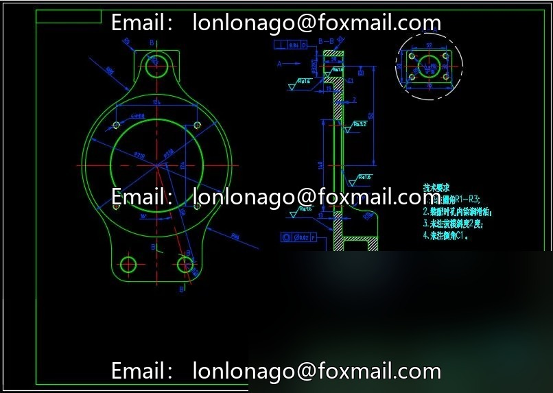
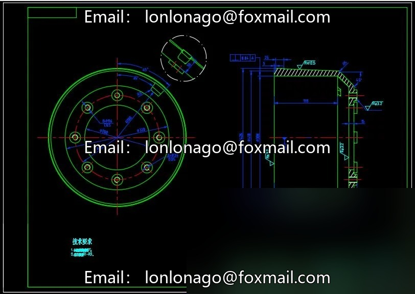
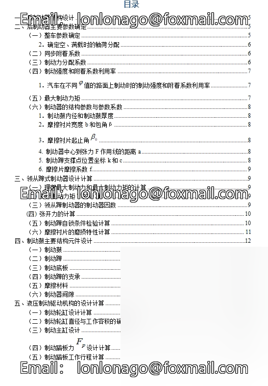
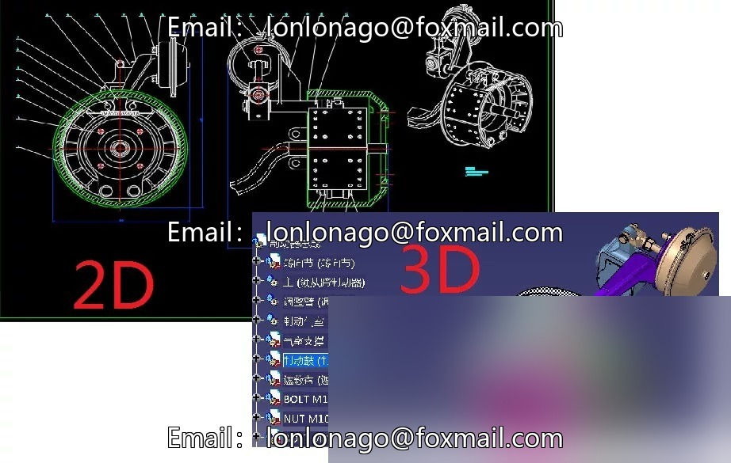

# Pressure cam drum brake CAD drawing

## Body

Pressure convex cam drum brake CAD drawing - pressure convex cam driven drum brake design - aerodynamic drum brake design - drum brake CAD drawing - drum brake 3D drawing
Contains assembly drawings of pressure convex cam driven drum brake, part drawings, and design descriptions - 36

The CAD figure covers pneumatic drum brake components, including assembly drawings, part drawings, design explanations, structural design, and parameter calculations.

<!-- AI_ENRICHED -->

## Images

## Payment

Here is a pay link on Stripe ( https://buy.stripe.com/3cs8yP7sY87d0vu9AB ). Please contact me lonlonago@foxmail.com after funding $89, and I will send you a complete data files , thank you!

